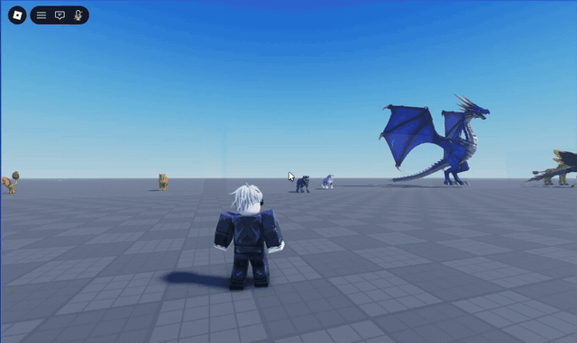
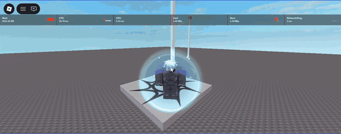
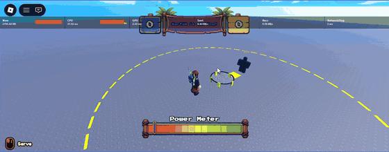
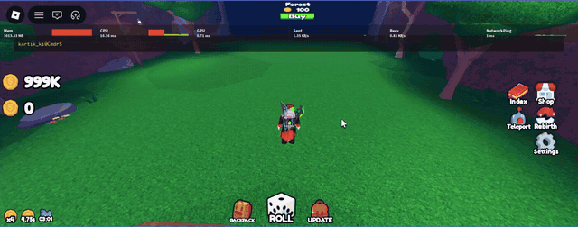

# 🎮 Roblox Developer Portfolio

[Games](#-games) · [Showcases](#-system-showcases) · [Code](#-code) · [Contact](#-contact)

---

## 👋 About

Hi, I'm a Roblox developer. I've been making games for more than 4 years and I mostly work on gameplay systems, UI and performance. When I can, I write my own simple systems (for example my own deterministic physics) instead of relying on Roblox physics.

Here are some of the games I worked on and a few clips of systems I made. If you're here to look at my work, I hope we can work together.

**A note about AI:** I use AI as a helper, for example to ask questions, check ideas or speed up small things. I don't use it to generate entire games or systems. The code and the design decisions are mine.

---

## 🎮 Games

### 🧟 Infected Wave

Zombie survival. You fight endless waves of zombies that get harder with time, earn trophies and cash, unlock better weapons, train your strength and try to get on the leaderboards. You can play with friends.

### 💥 Power Rampage

Destroy a city. You punch buildings, roads and other objects into scrap, sell the scrap for cash and buy upgrades for punch strength, carrying capacity and walk speed.

### 🎁 Our Present

Point-and-click escape room. You wake up in a strange room the day before New Year's and need to find a way out before a hidden timer runs out. Pick up items, read notes, solve puzzles. There are 6 endings. It also has a cutscene and a flashlight.

### 🌴 Swing Rush Obby

A jungle obby about rope swinging. You swing over obstacles and go through 150 stages to reach the finish.

### 🧩 Guess It
 

Inspired by the TikTok "Guess The Block" videos. You guess Minecraft blocks, and players can also make their own guess games, so it can be about other series, anime and so on. It has prompts, you can see other players' answers, and chests give different loot.

---

## 🎬 System Showcases

Short clips recorded in Roblox Studio. The GIF is a preview, the link below it opens the full video.

### Creature Capture

  

You start capturing a creature, a "Capturing…" text and a ring with particles show up, and after that you get "Caught Raccoon – Success: captured!". The test scene has creatures of different sizes, including a big dragon.

[Full video](media/videos/creature-capture.mp4)

### Rope Swing

  

The player grabs a rope and swings around the anchor point. A "Jump To Release" hint shows up, and jumping lets go of the rope and launches the player.

[Full video](media/videos/rope-swing.mp4)

### Volleyball

  

A serve with a power meter (timing decides how good the hit is, you can see "Great!"), then a rally against a bot. Controls are Hit, Spike, Pass and Dive. The ball uses custom physics on the server, and the client draws it smoothly.

[Full video](media/videos/volleyball.mp4)

### Pet Collecting

  

A pet collecting game with a forest zone. The Roll button gives you new pets, and the Backpack shows your pets with Sort and Equip Best. There are also Index, Shop, Teleport and Rebirth buttons, a gamepass menu (extra slots, Lucky Rolls, Fast Roll) and an upgrade popup for luck and auto roll.

[Full video](media/videos/pet-gacha.mp4)

---

## 💻 Code

If you want to see how I structure my code, look at the [`CodeShowcase`](CodeShowcase) folder. These are files from my game framework **TwistedSide**, copied unchanged and in their original Rojo folder layout. The third-party packages I use (ProfileStore, GoodSignal) and the files that only support these ones are not included, so this is for reading, not for running.

The idea behind the framework: every system is a small module, systems don't call each other directly, and they talk through named signals.

### How it boots

[`main.server.lua`](CodeShowcase/src/server/main.server.lua) and [`main.client.lua`](CodeShowcase/src/client/main.client.lua) are only a few lines each. They declare signals, gather a folder of modules, and initialise them. No game logic lives in them.

### Why these files are good

**[`Loader.lua`](CodeShowcase/src/shared/Loaders/Loader.lua): module bootstrap**
- Every `require` is wrapped in `pcall`. If one module is broken, you get a warning with its full path and the rest of the game still starts.
- Ordering is opt-in. A module can export `GetPriority()` (lower runs first, default 0), so `DataService` can start before `PlayerService` without a hard-coded list of modules.
- Gathering and initialising are separate steps. All modules are loaded first, then `Init()` is called, so `require` order never causes circular-dependency problems.
- The same loader runs on the server and the client.

**[`ServiceProvider.lua`](CodeShowcase/src/shared/Providers/ServiceProvider.lua): service locator**
- Written with `--!strict` and typed registries.
- `waitGet(name, timeout)` waits for a service that isn't registered yet, but gives up after a timeout and warns. A missing service shows up as a clear message and not as a script that hangs forever.
- `getRobloxService` caches results and wraps `GetService` in `pcall`.

**[`DataService.lua`](CodeShowcase/src/server_storage/Services/DataService.lua): player data sessions**
- Built on [ProfileStore](https://github.com/MadStudioRoblox/ProfileStore), following its session pattern. The wiring into the rest of the game is mine.
- It handles the awkward cases: the player leaves while their profile is still loading (the session is ended and not left locked), the session ends while the player is still in the game, for example another server takes it over (the player is kicked so they can't keep playing on stale data), and players who joined before the service started.
- The `Cancel` callback stops waiting for a profile once the player is gone.
- When data is ready, it fires a `PlayerDataLoaded` signal and knows nothing about who listens.

**[`PlayerService.lua`](CodeShowcase/src/server_storage/Services/PlayerService.lua) and [`SignalsLoader.lua`](CodeShowcase/src/server_storage/Loaders/SignalsLoader.lua): event-driven pipeline**
- `PlayerService` is tiny. It listens for `PlayerDataLoaded`, builds the player object and fires `PlayerClassLoaded`. Each stage does one job, and new systems (such as weapons) plug in by listening to the next signal.
- All signals are declared in one place, so you can see every event the server uses in one file.

**[`Input.lua`](CodeShowcase/src/shared/Classes/Input.lua) and [`InputController.lua`](CodeShowcase/src/shared/Controllers/InputController.lua): input handling**
- `Input` wraps `ContextActionService`. It warns on double binding and keeps each action's callback and touch-button setting, so `RebindAction` can change keys without the caller re-supplying them.
- `InputController` turns raw input into one `InputBegan` signal (action name + input object). Gameplay code listens to that signal and never touches input APIs, so changing key bindings doesn't touch combat code.

---

## 📫 Contact

I'm open to new projects. You can reach me through my GitHub: [@Usarass](https://github.com/Usarass)

Discord: `usaras`
